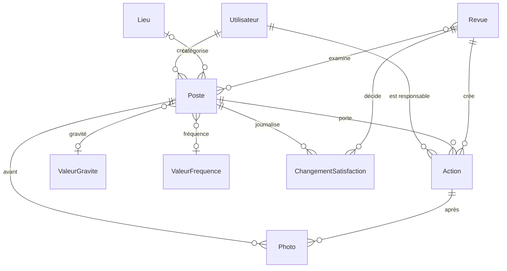

# Dudu — Spécification technique

Détails d'implémentation de l'application décrite dans « Spec Dudu.md ».
Ce document évolue avec le code ; la spec fonctionnelle reste la
référence métier.

## Architecture générale

- **Une application Django unique** (`dudu`), templates Django + HTMX
- **Pas de build front** : MapLibre GL JS, Terra Draw et HTMX servis en
  fichiers statiques ; un pont JavaScript minimal relie l'instance de
  carte MapLibre et les fragments HTMX
- **Serveur applicatif** : gunicorn (WSGI, multiplicatif du Ruby Unicorn,
  projet open source actif) ; pas de nginx
- **Fichiers statiques** : servis par l'app elle-même via WhiteNoise —
  c'est ce qui permet un conteneur unique
- **SQLite** en mode WAL, fichier unique dans `/data/db.sqlite3`
- **Media** : photos dans `/data/photos/AAAA/`, redimensionnées à
  ~1600 px JPEG (Pillow) à l'upload
- **Déploiement** : conteneur unique (gunicorn + WhiteNoise + Pillow),
  volume `/data` persistant (base + photos + plans + sauvegardes)

## Modèle de données

- **Poste** : nom, description, auteur, date de création, lieu,
  position (lat/lng WGS84 obligatoire), statut de satisfaction
  (FK ValeurSatisfaction), gravité + fréquence (FK listes admin),
  origine du signalement (constat / presqu'accident / accident),
  archivé booléen, journal d'édition (qui, quand) pour la traçabilité
  animateur
- **Photo** : type (avant / après), fichier, auteur, date ; rattachée
  à un poste ou à une action
- **Action** : poste (FK), intitulé, description, responsable
  (obligatoire), échéance (obligatoire), statut
  (à faire / en cours / faite / abandonnée), motif si abandonnée,
  position (copiée du poste, modifiable), revue de création (FK null
  si action urgente hors revue)
- **Revue** : date, participants (M2M), postes examinés (M2M),
  compte rendu libre
- **ChangementSatisfaction** : revue, poste, ancienne valeur,
  nouvelle valeur — journal historique
- **ValeurSatisfaction / ValeurGravite / ValeurFrequence** : listes
  modifiables dans l'admin (libellé, ordre, couleur du marqueur)
- **PlanBatiment** : nom, étiquette (ex. « Hangar — étage »), nature
  au choix :
  - **forme dessinée** : polygone GeoJSON tracé à la souris (Terra Draw)
  - **image importée** : fichier PNG/JPG dans `/data/plans/` + 4 coins
    en WGS84 pour le calage + opacité (défaut 50 %), calage à la
    souris par poignées de coin
  - couleur, ordre d'affichage ; dessiné/calé dans une page admin

## Règles implémentées et testées

Tests unitaires Django sur les règles de gestion de la spec
fonctionnelle :

1. Action sans responsable ou sans échéance : refus
2. Changement de satisfaction hors revue : refus
3. Action urgente hors revue : réservée à l'animateur, marquée
   « à inscrire à la prochaine revue »
4. Suppression de poste : impossible — archivage seulement
   (l'historique reste consultable)
5. Passage en « faite » sans photo « après » : avertissement,
   non bloquant
6. Édition d'un poste par l'animateur : journalisée
   (« modifiée par X le Y »)

## Carte

- **MapLibre GL JS**, fond orthophoto IGN (tuiles WMTS de la
  géoplateforme), attribution IGN affichée
- Positions stockées en WGS84 (lat/lng), rendu Mercator standard
- **Terra Draw** activé uniquement sur : placement du point d'un
  poste (création/édition) et dessin des formes dans l'admin plans
- **Plans de bâtiments** : formes dessinées ou images importées,
  dans le même système de coordonnées ; les étages sont dessinés
  les uns à côté des autres (« chez le voisin »), pas empilés
- **Calage des images** : source MapLibre de type image + 4 coins ;
  éditeur de calage maison (poignées de coin, déplacement, échelle,
  opacité) — environ 150 lignes de JS
- Marqueurs : couleur selon la cotation santé/sécurité, halo selon
  la satisfaction ; clic → panneau latéral HTMX du poste
- Le pont JS : MapLibre gère les interactions carte, HTMX met à
  jour les panneaux ; aucune instance MapLibre n'est recréée par une
  navigation HTMX

## Écrans

1. **Tableau de bord** : postes actifs, actions en retard,
   répartition des satisfactions, prochaine revue
2. **Postes** : liste avec filtres (lieu, satisfaction, gravité) ;
   bascule carte / liste
3. **Poste** (détail) : cotation, photos avant, actions liées,
   historique de satisfaction, commentaires
4. **Actions** : par responsable, par statut, retards en évidence
5. **Revue** : sélection des postes examinés, mise à jour des
   satisfactions, création des actions, compte rendu ; affichage
   avant / après des actions clôturées depuis la revue précédente
6. **Admin Django** : utilisateurs et rôles, lieux, listes de
   valeurs, plans de bâtiments (dessin / calage)

## Sécurité et déploiement

- Authentification Django (sessions), rôles par flags
  (is_animateur, is_staff)
- **Aucune exposition publique** : conteneur sur le réseau local du
  club, accès distant uniquement via WireGuard ; CSRF Django actif
- **Dockerfile** unique, `docker compose` avec volume `/data`
- **Sauvegarde** : script + cron quotidien — sauvegarde à chaud de
  SQLite (`.backup`) + rsync des photos et plans vers
  `BACKUP_DEST` configurable, rétention 90 jours, contrôle simple
  (taille + nombre de fichiers)
- **Mises à jour** : image reconstruite depuis `main`, volume
  `/data` jamais écrasé, migrations Django automatiques

## Plan de développement

| Jalon | Contenu | Dépend de |
| --- | --- | --- |
| M0 | Socle projet, auth, rôles, squelette UI | — |
| M1 | Postes : CRUD, filtres, cotation santé/sécurité | M0 |
| M2 | Actions + règles + tests | M1 |
| M3 | Carte MapLibre : ortho IGN, positionnement des postes | M1 |
| M4 | Revues : satisfaction journalisée, création d'actions | M2 |
| M5 | Photos avant/après + compression | M1, M2 |
| M6 | Plans de bâtiments : formes dessinées et calage d'images | M3 |
| M7 | Conteneur, sauvegarde, déploiement club | tous |

M0 à M2 constituent un noyau utilisable sans carte ; la carte (M3)
arrive ensuite pour ne pas bloquer la saisie des premiers postes
réels.
